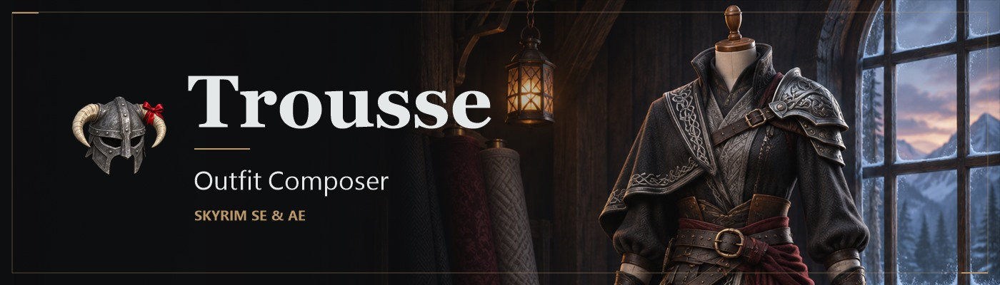

# Trousse

Trousse combines clothing and armor from your installed BodySlide projects into Skyrim Special Edition and Anniversary Edition replacers. Choose the game item to replace, assemble pieces across mods, inspect the result in 3D, and export a package for Vortex and BodySlide.

## Build from source on Windows

1. In GitHub, choose **Code → Download ZIP** and extract the entire archive to a writable folder. You can also clone the repository.
2. Open **Build.bat**. The script uses the 64-bit .NET Framework compiler on Windows. It needs neither Visual Studio nor downloaded build dependencies.
3. Open **bin\Trousse.exe** when the build finishes. The output is a portable 64-bit Windows application.

Windows 10 or 11 (64-bit) with .NET Framework 4.x and Windows PowerShell is required for this build. Skyrim, Vortex, and BodySlide are used when working with outfits and are separate from the build.

For a build from Command Prompt with no pause:

```bat
Build.bat --no-pause
```

## Build your first replacer

1. Install [BodySlide and Outfit Studio](https://www.nexusmods.com/skyrimspecialedition/mods/201) 6.1.0 or later. Deploy BodySlide and the source outfit mods in Vortex.
2. In Trousse, set the Vortex mod staging folder and the deployed BodySlide folder in **Settings**, then select **Scan library**.
3. In **Compose**, select an item from the base game or official DLC. Add pieces from your BodySlide library and inspect the live 3D preview.
4. Select **Add to package**. When your outfits are ready, choose **Package → Export Vortex ZIP**.
5. Install and deploy the exported outfit package in Vortex. Open BodySlide, select the generated replacer and your body preset, and build the outfit.

Keep the source outfit mods and their dependencies installed for textures, physics and other referenced assets. The ZIP includes an outfit report and a list of required mods.

## In Vortex Tools

In **Skyrim Special Edition → Tools → +**, name the tool **Trousse** and set its target to the newly built **bin\Trousse.exe**. Keep the executable in that location after adding the shortcut.

To build the optional Vortex extension and portable ZIP locally, run the following from the repository root. Both archives will be written to **dist**.

```bat
powershell.exe -NoProfile -ExecutionPolicy Bypass -File .\Pubblica.ps1
```

Install the generated **Vortex-Extension.zip** through **Home → Extensions → Drop File(s)** and restart Vortex. With Skyrim Special Edition detected in Vortex, Trousse appears in **Tools**. Use the Skyrim **Mods** page for the outfit packages you export from inside Trousse.

## Features

- **Compose** with textured or per-part colors in the live 3D preview. Conflicts that Trousse can identify are highlighted in the affected outfit.
- **Variants and records** shows console FormIDs, texture sets and shared Armor Addons. Compatible variants can be assigned separate replacement meshes.
- **Installed outfit** shows deployed meshes, with filters and a console command for the selected item.
- **Bodies and Poses** previews installed CBBE presets and compatible poses, and supports Poser Hotkeys Plus favorites.
- **Modesty and OAR** helps configure coverage and race-specific animation rules when the relevant mods are installed.
- **Dress Up Lovers** exports named outfit presets for import through that mod's MCM.

See the in-app **Guide** or the [English and Italian release guide](release/README.txt) for details.

## Source and credits

- [src](src) contains the C# and WPF application.
- [vortex](vortex) contains the optional Vortex launcher extension.
- [assets](assets) contains the Trousse icon and startup illustration. The source archive uses the app's fallback branding and ships without the optional music and sound files. You can select your own audio in Settings.
- [Third-party notices](THIRD-PARTY-NOTICES.md) lists the upstream BC7 tables.

Trousse is an independent utility for Skyrim. Thanks to the creators of BodySlide and Outfit Studio, Vortex, and the supported mods.
